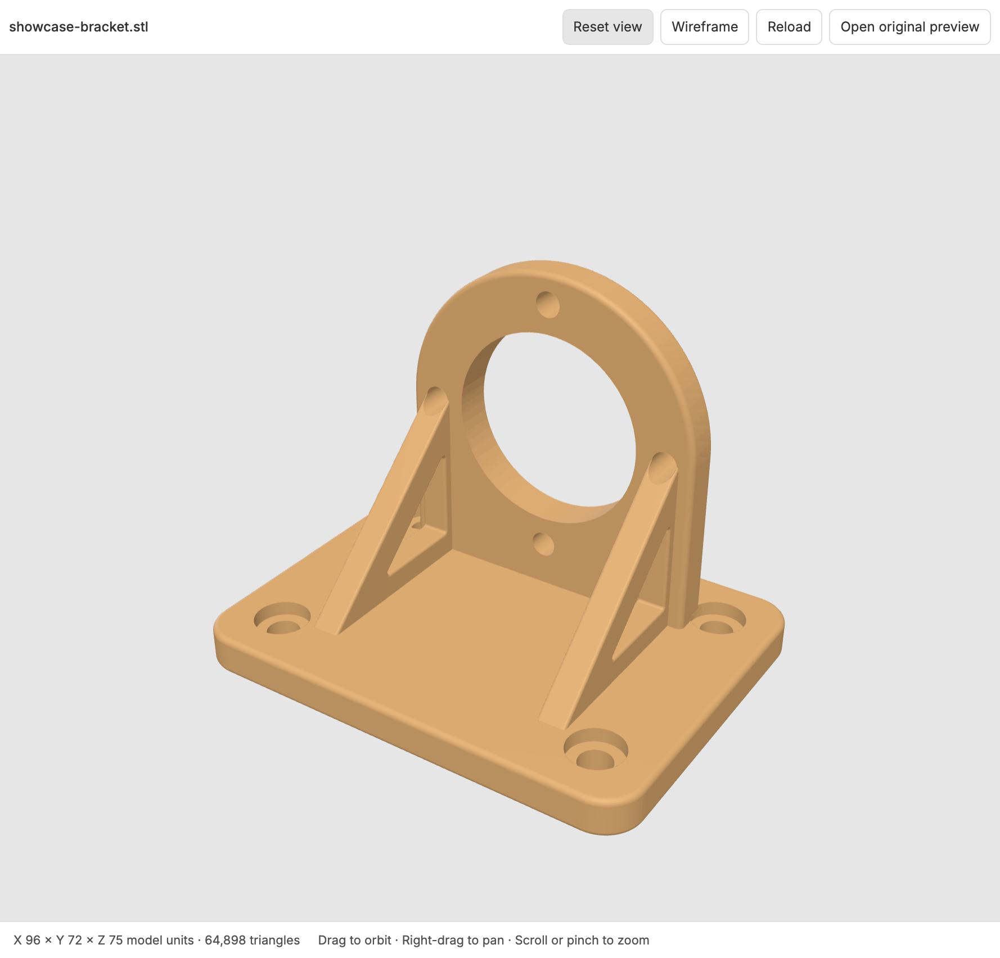
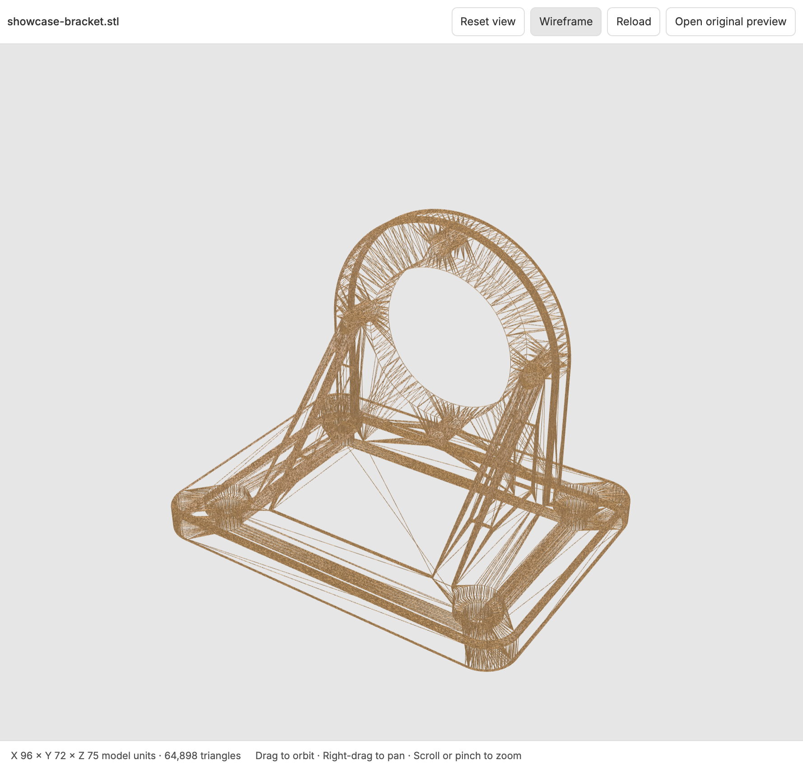

# STL Preview for BB

Inspect 3D models without leaving your BB thread. Click an STL file to rotate, pan, zoom, or switch to wireframe in the side panel.



## Install

```sh
bb plugin install git:https://github.com/obostjancic/bb-plugin-stl-preview.git@^0.1.0
```

Requires **BB 0.46+**, Plugin SDK **0.6.49+**, and a **WebGL2**-capable browser or desktop client. No separate viewer, account, or API key.

Click an `.stl` file link in chat or use the file picker. From an agent thread:

```sh
bb thread open path/to/model.stl
```

If another opener is pinned, choose **STL Preview** under **Settings → File openers**, or right-click a file link and choose **Open with**.

## Inspect the mesh

- **Orbit, pan, zoom:** drag to orbit, right-drag to pan, scroll to zoom. On touch screens, one finger orbits; two fingers pan and pinch to zoom.
- **Reset view:** fit the whole model back into view.
- **Wireframe:** inspect the STL's triangle mesh.
- **Dimensions:** read X/Y/Z bounding dimensions and the triangle count in the footer.
- **Reload:** fetch the latest file after an agent changes it.
- **Open original preview:** switch back to BB's built-in preview.

STL files contain no unit metadata. Dimensions are shown in **model units**, not assumed millimeters.



## Try the sample

Open [`examples/showcase-bracket.stl`](examples/showcase-bracket.stl) after cloning the repository. The original demo includes rounded edges, counterbored mounting holes, an arched upright, and reinforcing ribs with openings.

The sample measures **96 × 72 × 75 mm** and is one watertight, consistently wound mesh. It is a display sample, not a load-rated bracket or a verified print profile. The [parametric source](examples/showcase-bracket.py) is included under the same MIT license.

To regenerate the sample with [uv](https://docs.astral.sh/uv/):

```sh
uvx --no-config --managed-python --python 3.13 --from cadgen==0.7.15 python examples/showcase-bracket.py
```

Python and cadgen are needed only to regenerate the sample, not to use the viewer.

## File access and limits

Supports **binary and ASCII STL**, up to **64 MiB** and **one million triangles**.

Workspace, project, host, and thread-storage files load through BB's existing authenticated file routes, including selected remote hosts. Models are rendered in your client; the plugin does not upload them to an external service or open another server port.

Files load when opened. Use Reload after changes; automatic file watching is not included. Malformed, empty, nonfinite, and oversized files show an error with retry and original-preview controls. Parsing happens on the client's main thread, so large meshes can briefly pause the interface.

This is a viewer, not a model editor, repair tool, or slicer.

## Development

```sh
npm ci
npm test
npm run typecheck
npm run format:check
bb plugin build .
bb plugin install . --yes
```

After editing, rebuild and run `bb plugin reload stl-preview`. React and the BB SDK are provided by the host. Three.js is bundled into the viewer; rendering is on demand, with graphics resources and file requests cleaned up on close or reload.

## License

[MIT](LICENSE). Built with [Three.js](https://threejs.org/), also MIT licensed.
